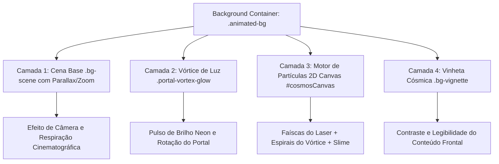

# 🛸 Rick and Morty - Multiverse Explorer

Uma aplicação web moderna, imersiva e responsiva desenvolvida em **HTML5**, **CSS3 puro** e **JavaScript vanilla (ES6+)**, consumindo a [The Rick and Morty API](https://rickandmortyapi.com/). O projeto oferece aos fãs e desenvolvedores uma experiência visual cósmica completa para explorar personagens, variantes interdimensionais, episódios e localizações da série.

---

## 🌀 1. A Animação de Fundo (Como Foi Feita e Como Funciona)

O ponto central da identidade visual do site é o seu **plano de fundo animado**, no qual **Rick Sanchez empunha sua Portal Gun e abre um portal interdimensional dinâmico**.

Para atingir um visual que parece um papel de parede vivo com alta performance (60 FPS constantes sem sobrecarregar a GPU ou CPU), a animação foi construída utilizando uma **arquitetura de renderização híbrida em 4 camadas**:



---

### 🎨 Detalhamento das 4 Camadas da Animação

#### 🔹 Camada 1: Cena Base com Movimento Cinematográfico (`.bg-scene`)
- **Arquivo de Mídia**: [imgs/rick_portal_bg.jpg](imgs/rick_portal_bg.jpg).
- **Conceito**: Uma arte widescreen 16:9 de alta definição que retrata Rick sobre um rochedo disparando seu feixe de laser verde em direção ao cosmos.
- **Como é animada**: Através do keyframe CSS `@keyframes bgCinematicFloat`, a imagem sofre uma leve variação cíclica de escala (`scale(1.02)` até `scale(1.06)`) e translação suave (`translate(-0.8%, -0.5%)`) ao longo de 14 segundos. Isso elimina a sensação de imagem estática, gerando uma respiração de câmera fluida e cinematográfica.

```css
.bg-scene {
  position: absolute;
  inset: -30px;
  background-image: url('imgs/rick_portal_bg.jpg');
  background-size: cover;
  background-position: center 25%;
  filter: saturate(1.2) contrast(1.08) brightness(0.88);
  animation: bgCinematicFloat 14s ease-in-out infinite alternate;
  transform-origin: 65% 40%;
}
```

---

#### 🔹 Camada 2: Vórtice de Luz e Pulso Eletromagnético (`.portal-vortex-glow`)
- **Conceito**: Posicionada exatamente sobre as coordenadas do portal verde na arte (canto superior direito).
- **Como é feita**: Usa um `radial-gradient` com cores neon `#39ff14` (verde portal) e `#00f0ff` (ciano dimensional), associada ao modo de mesclagem `mix-blend-mode: screen` e desfoque óptico (`filter: blur(28px)`).
- **Animação**: A animação `@keyframes portalVortexPulse` rotaciona o gradiente em 360° enquanto expande e contrai a intensidade do brilho luminoso (`filter: brightness(1.45)`), criando a ilusão de energia viva e instabilidade dimensional.

```css
.portal-vortex-glow {
  position: absolute;
  right: 5%;
  top: 8%;
  width: 55vw;
  max-width: 720px;
  height: 55vw;
  max-height: 720px;
  border-radius: 50%;
  background: radial-gradient(circle, rgba(57, 255, 20, 0.45) 0%, rgba(0, 240, 255, 0.35) 30%, transparent 72%);
  mix-blend-mode: screen;
  animation: portalVortexPulse 5s ease-in-out infinite alternate;
}
```

---

#### 🔹 Camada 3: Motor de Física de Partículas em Tempo Real (`#cosmosCanvas`)
Implementado no módulo `CosmosCanvas` em [script.js](script.js), utiliza o contexto 2D nativo do HTML5 Canvas (`CanvasRenderingContext2D`) e `requestAnimationFrame` para desenhar 4 sistemas de partículas simultâneos:

1. **Faíscas do Raio da Portal Gun (`laserSparks`)**:
   - O código calcula dinamicamente os pontos de ancoragem da ponta da arma do Rick (`gunX`, `gunY`) e o ponto de impacto no centro do portal (`portalX`, `portalY`).
   - Partículas viajam em alta velocidade em interpolação linear (`curX = gunX + (portalX - gunX) * progress`), com pequenas vibrações (`jitter`), emitindo faíscas verdes com `shadowBlur`.
2. **Espirais do Vórtice do Portal (`portalSpirals`)**:
   - Dezenas de partículas calculadas via trigonometria (`px = portalX + cos(angle) * dist` e `py = portalY + sin(angle) * dist`).
   - Giram continuamente em torno do vórtice em diferentes raios e velocidades angulares, alternando entre verde neon e azul ciano.
3. **Bolhas de Slime Radioativo (`slimeBubbles`)**:
   - Bolhas verdes com bordas iluminadas que emergem lentamente do fundo da tela em direção ao topo, oscilando lateralmente com base em uma função senoidal (`Math.sin(time + y * 0.02)`).
4. **Estrelas Multiversais Cintilantes (`stars`)**:
   - Poeira estelar distribuída pelo espaço com pulsação de opacidade alfa variável.

```javascript
// Exemplo: Cálculo responsivo dos pontos de disparo da arma e impacto no portal
getAnchors() {
  const w = this.canvas.width;
  const h = this.canvas.height;
  return {
    gunX: w > 768 ? w * 0.38 : w * 0.25,
    gunY: w > 768 ? h * 0.43 : h * 0.45,
    portalX: w > 768 ? w * 0.72 : w * 0.65,
    portalY: w > 768 ? h * 0.36 : h * 0.38,
    portalRadius: Math.min(w, h) * 0.28
  };
}
```

---

#### 🔹 Camada 4: Vinheta Cósmica e Otimização de Leitura (`.bg-vignette`)
- Uma camada de gradiente radial e linear escuro projetada estrategicamente.
- O portal e o Rick recebem menos opacidade para ficarem visíveis no Hero, enquanto as regiões inferiores (onde ficam os filtros e os cards de personagens) escurecem suavemente para `rgba(6, 9, 19, 0.92)`, garantindo **legibilidade impecável (WCAG)** para todos os textos.

---

## ⚡ 2. Recursos e Funcionalidades do Site

### 🔍 Busca em Tempo Real com Debounce
- Digitação rápida na barra de busca com atraso inteligente de **400ms**.
- Evita dezenas de requisições desnecessárias à API enquanto o usuário digita.
- Botão instantâneo para limpar a busca.

### 🎛️ Filtros Combinados Multidimensionais
- **Status Vital**: Vivo (Alive), Morto (Dead), Desconhecido (Unknown).
- **Espécies**: Humano, Alienígena, Robô, Cronenberg, Poopybutthole, etc.
- **Gênero**: Feminino, Masculino, Sem gênero, Desconhecido.
- **Reset Rápido**: Restaura todos os seletores e a busca com um clique.

### 📄 Paginação Inteligente e Dinâmica
- Navega pelas mais de 42 páginas catalogadas da API.
- Botões de Primeira e Última página, Anterior e Próxima.
- Marcadores numéricos compactos com elipses (`...`) dinâmicas.

### 📇 Modal Completo com Histórico de Episódios
- Ao clicar em qualquer card, uma ficha interdimensional detalhada se abre via modal com efeito *glassmorphism*.
- Mostra: Avatar ampliado, Planeta de Origem, Localização Atual, Espécie, Gênero e Status.
- **Catálogo de Episódios**: Faz a busca assíncrona dos nomes dos episódios em que o personagem apareceu, formatando chips como `S01E01: "Pilot"`, com sistema de cache em memória para não repetir chamadas de rede.

### ⭐ Mochila de Favoritos (Persistência Local)
- Salve qualquer personagem nos favoritos clicando na estrela (`☆` / `★`).
- Os dados persistem no navegador através de `localStorage`.
- Aba dedicada **"Favoritos na Mochila"** com contador em tempo real no cabeçalho e estatísticas.

### 🔫 Teletransporte Aleatório (Portal Gun)
- Botão no cabeçalho que sorteia aleatoriamente um personagem entre os 826 existentes no multiverso.
- Dispara um som de portal e abre diretamente a ficha do indivíduo sorteado.

### 📺 Central de Transmissão Oficial (Onde Assistir às Temporadas)
- Módulo integrado para roteamento seguro de streaming com links diretos oficiais para assistir às temporadas da série:
  - **Max (antiga HBO Max)**: Provedor oficial no Brasil com todas as 7 temporadas dubladas e legendadas em 4K.
  - **Adult Swim Oficial**: Portal original da Warner/Cartoon Network com maratonas 24/7 e episódios ao vivo.
  - **Guia JustWatch**: Disponibilidade de streaming em tempo real, compra e aluguel nas plataformas brasileiras.
- **Atalhos Rápidos de Temporadas**: Botões de acesso imediato às Temporadas 1 a 7.
- Acesso fácil pelo cabeçalho (*"Assistir Série"*), no Hero (*"Onde Assistir às Temporadas"*) e dentro de cada modal de personagem.

---

## 🏗️ 3. Arquitetura e Estrutura do Código

O projeto segue rigorosamente a separação de responsabilidades (HTML semântico, CSS modular com Design Tokens, e JavaScript limpo):

```text
site-marvel/
├── imgs/
│   └── rick_portal_bg.jpg      # Arte em alta resolução do Rick e o Portal
├── index.html                  # Estrutura semântica, meta tags SEO e acessibilidade
├── style.css                   # Sistema de design, variáveis CSS, animações e responsividade
├── script.js                   # Lógica assíncrona, API, Web Audio e Canvas 2D
└── README.md                   # Esta documentação completa
```

### Tecnologias e Bibliotecas Utilizadas:
- **HTML5 Semântico**: Elementos `<header>`, `<nav>`, `<main>`, `<section>`, `<article>`, `<dialog>`, etc.
- **CSS3 Vanilla**: CSS Grid, Flexbox, Custom Properties (`--portal-neon`, `--bg-card`), animações `@keyframes` e `backdrop-filter`.
- **JavaScript ES6+**: Módulos lógicos (`ApiService`, `FavoritesManager`, `AudioService`, `CosmosCanvas`, `UI`, `App`), `async/await`, `Fetch API` e `LocalStorage`.
- **Tipografia**: Google Fonts (*Space Grotesk* e *Outfit*).
- **API Externa**: [The Rick and Morty API](https://rickandmortyapi.com/).

---

## 🚀 4. Como Executar Localmente

### Opção 1: Servidor Local Python (Recomendado)
Na pasta do projeto, execute no terminal:
```bash
python -m http.server 8000
```
Em seguida, abra seu navegador em:
```text
http://localhost:8000
```

### Opção 2: Node.js (via npx)
```bash
npx serve .
```

### Opção 3: Execução Direta
Basta dar um duplo clique no arquivo [index.html](index.html) para abri-lo em qualquer navegador moderno.

---

## 👨‍💻 Créditos
- Dados fornecidos pela excelente [The Rick and Morty API](https://rickandmortyapi.com/) criada por Axel Fuhrmann.
- Universo criado por Dan Harmon e Justin Roiland para o canal Adult Swim.
